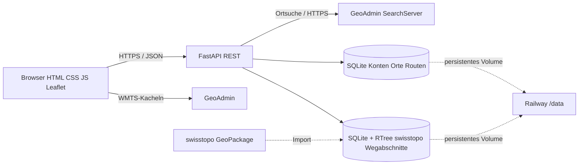

# SwissTrail – HSLU Angewandte Informatik

Browserbasierter Wanderweg-Explorer für das Kundenprofil **Smart Travel / Tourismusbüro**. SwissTrail verbindet eine moderne HTML-/CSS-/JavaScript-Oberfläche mit einer eigenen FastAPI-REST-API, GeoAdmin-Ortssuche, offiziellen swisstopo-Wanderwegsegmenten und einer persistenten SQLite-Datenbank.

**[Live-Webseite](https://swisstrail-hslu-production.up.railway.app/)** · [Projektanwendung und technische Dokumentation](SwissTrail_HSLU_Projekt_V2/swisstrail/README.md) · [Software-Spezifikation](SwissTrail_HSLU_Projekt_V2/swisstrail/docs/SPEZIFIKATION.md) · [Tests](SwissTrail_HSLU_Projekt_V2/swisstrail/docs/TESTPLAN.md) · [Security](SwissTrail_HSLU_Projekt_V2/swisstrail/docs/SECURITY.md) · [Präsentationsfahrplan](SwissTrail_HSLU_Projekt_V2/swisstrail/docs/PRAESENTATION.md).

## Kundenproblem
Gäste und Wandernde wollen Schweizer Wanderwege und Orte unkompliziert auf einer Karte finden und persönliche Ziele beziehungsweise selbst geplante Strecken speichern.

## Wesentliche Funktionen
1. Schweizer Orte mittels **GeoAdmin SearchServer** suchen und zur Karte navigieren.
2. Offizielle Wanderwege aus einem swisstopo-GeoPackage als **einzelne Segmente anklicken**: Länge und Kategorie abfragen.
3. Benutzerkonten, persönliche Merkliste mit Notizen sowie eigene Routen (2D-Länge, selbstgewählte Schwierigkeit) anlegen, abrufen und löschen.
4. Wanderkarten-Layer ein-/ausblenden; interaktive Regionen entdecken.

## Architektur


## Deployment
Railway, Projekt `adaptable-balance`, Service `swisstrail-hslu`, Branch `main`, Repository-Unterverzeichnis `SwissTrail_HSLU_Projekt_V2/swisstrail`. Persistentes Volume `/data`, `SWISSTRAIL_DB=/data/swisstrail.db`, `SWISSTRAIL_TRAILS_DB=/data/trails.db`, `SWISSTRAIL_SECURE_COOKIE=1`, `PORT=8000`. Die GeoPackage-Daten werden mit `scripts/import_trails.py` importiert (oder einmalig via `SWISSTRAIL_AUTO_IMPORT=1`). Keine Datenbank als Fremdservice.

## Lokale Installation
```bash
cd SwissTrail_HSLU_Projekt_V2/swisstrail
python -m pip install -r requirements.txt
python -m uvicorn app:app --reload
# Webseite: http://127.0.0.1:8000
# Tests: python -m pytest -q
```
Der lokale Start ermöglicht Benutzerfunktionen und GeoAdmin-Suche. Für offizielle Segmentklicks ist zusätzlich eine importierte `trails.db` erforderlich; siehe [Importanleitung](SwissTrail_HSLU_Projekt_V2/swisstrail/docs/RAILWAY_DEPLOYMENT.md).

## Technische Entscheidungen und Grenzen
- **SQLite + Volume** statt externer DB-Dienst: einfach, kurskonform, dafür weniger geeignet für hohe gleichzeitige Schreiblast.
- **WMTS + swisstopo-GeoPackage**: schnelle visuelle Karte plus präzise Einzelabschnitts-Abfrage; **kein** vollständiges Start-Ziel-Routing.
- **FastAPI + Pydantic**: Validierung und klare JSON-Endpunkte, benötigt aber zusätzliche Härtung für produktiven Publikumseinsatz.
- Einzelabschnitte zeigen die swisstopo-Kategorie, **nicht** SAC T1–T6. Selbst gezeichnete Routen werden als Folge von 2D-Stützpunkt-Distanzen berechnet; Schwierigkeit gibt der Benutzer selbst an. Keine Wetter-, Sperrungs- oder Lawineninformationen.

## Qualität / Sicherheit
Unit- und API-Integrationstests: `python -m pytest -q`; GitHub Actions `tests.yml`. Live-Smoke-Test unter `.github/workflows/production-smoke.yml`. Manuelle Browser-Systemtests sind im Testplan separat dokumentiert und müssen vom Team tatsächlich durchgeführt werden. Passwörter werden mit scrypt+Salt verarbeitet; Sessions sind HttpOnly/SameSite, Railway-HTTPS und Secure-Cookie aktiviert. Einschränkungen siehe Security-Dokument.

## Team, Verantwortung und Projektmanagement
**Noch auszufüllen:** reale Teammitglieder, Rollen, Aufgabenverteilung, Milestones und persönliche Lessons Learned. Keine erfundenen Tätigkeitsnachweise verwenden. Fortschritt kann anhand der Git-History, der Issue-/Commit-Kommentare und des [Projektmanagement-Dokuments](SwissTrail_HSLU_Projekt_V2/swisstrail/docs/PROJEKTPLAN.md) nachvollzogen werden.

## Credits
[swisstopo / GeoAdmin](https://www.geo.admin.ch/) (Karten, SearchServer, swissTLM3D Wanderwege); [Leaflet](https://leafletjs.com/) (interaktive Karte); [FastAPI](https://fastapi.tiangolo.com/), [Pydantic](https://docs.pydantic.dev/), [Shapely](https://shapely.readthedocs.io/), [pyproj](https://pyproj4.github.io/pyproj/), SQLite; Railway (Hosting). HSLU Projektauftrag «Data Driven Webanwendung» (intern bereitgestelltes Aufgabenblatt).

**Schulprototyp, keine verlässliche Navigations- oder Sicherheitsanwendung.**