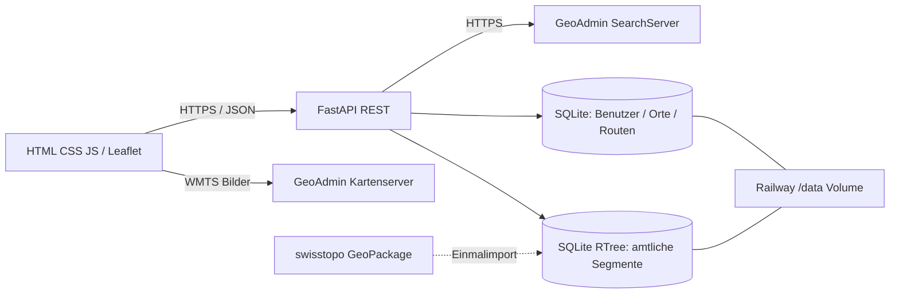

# SwissTrail – HSLU Angewandte Informatik (Version 4)
Kundenprofil **Smart Travel / Tourismusbüro**: Browserbasierte Karte mit GeoAdmin-Ortssuche, amtlichen swisstopo-Wanderwegabschnitten und persönlichen Tourideen.

**Live:** https://swisstrail-hslu-production.up.railway.app/

## Zwei wesentliche Benutzeroperationen
1. **Orte suchen:** Frontend → FastAPI `/api/geoadmin/search` → öffentlicher GeoAdmin SearchServer → JSON-Treffer → Kartenzentrierung.
2. **Offizielle Wegabschnitte prüfen:** Klick → FastAPI `/api/trails/nearby` → räumlicher SQLite-RTree-Index aus swissTLM3D-Wanderwegen → Abschnittslänge, Wegkategorie, Geometrie.

Zusätzlich: Konto registrieren/anmelden, Orte mit Notizen speichern/ändern/löschen, eigene Routen zeichnen, 2D-Distanz berechnen und Schwierigkeit selbst auswählen.

## Architektur


## Lokale Installation & Start
```bash
cd SwissTrail_HSLU_Projekt_V2/swisstrail
python -m pip install -r requirements.txt
python -m uvicorn app:app --reload
# http://127.0.0.1:8000
python -m pytest -q
```
GeoAdmin benötigt Internet. Ohne lokal importierte `trails.db` können Wegabschnitte nicht abgefragt werden. Anleitung: `docs/RAILWAY_DEPLOYMENT.md`.

## Deployment
GitHub-Branch `main` → Railway-Service `swisstrail-hslu` in Projekt `adaptable-balance`, Root `SwissTrail_HSLU_Projekt_V2/swisstrail`. Volume `/data`; Variablen `SWISSTRAIL_DB=/data/swisstrail.db`, `SWISSTRAIL_TRAILS_DB=/data/trails.db`, `SWISSTRAIL_SECURE_COOKIE=1`, `PORT=8000`. Kein externer DB-Service.

## Tests
`python -m pytest -q`; GitHub Actions `.github/workflows/tests.yml` und `.github/workflows/production-smoke.yml`; manuelle Testprotokolle in `docs/TESTPLAN.md`. Die Live-API für offizielle Segmente wurde am 09.11.2026 erfolgreich geprüft. Nach Änderungen Tests erneut ausführen.

## Technische Entscheidungen und Grenzen
SQLite auf einem Volume ist einfach und erfüllt den DB-Teil des Auftrags; ein Volume ist aber **kein Backup**. WMTS-Karten sind Bilder, deshalb separater GeoPackage-Import mit RTree-Index. FastAPI ermöglicht eine eigene JSON-REST-API mit Pydantic-Validierung.

**Wichtig:** Die amtliche Kategorie ist keine SAC-T1–T6-Bewertung. Nur ein einzelner Wegabschnitt wird gefunden, keine komplette Wanderroute. Selbst gezeichnete Routen verwenden eine Haversine-2D-Näherung und manuell gewählte Schwierigkeit. Keine Wegsperrungen, Wetterprüfung oder sichere Navigation.

## Weitere Dokumente
- [Anforderungen, C4-Komponenten und Datenmodell](docs/SPEZIFIKATION.md)
- [Testplan und nachvollziehbare Ergebnisse](docs/TESTPLAN.md)
- [Sicherheitskonzept](docs/SECURITY.md)
- [20-Minuten-Schlusspräsentation](docs/PRAESENTATION.md)
- [Projektplanung und Zuständigkeiten](docs/PROJEKTPLAN.md)

## Team & Credits
**Projektteam:** Vincent, Marlon, Enzkar und Kevin. Die genaue persönliche Aufgabenverteilung und individuelle Beiträge müssen vom Team mit echten Nachweisen ergänzt werden. Daten: swisstopo / geo.admin.ch, Leaflet; Technik: FastAPI, Pydantic, SQLite, shapely, pyproj, httpx, Railway. Bildungsprototyp im Rahmen des HSLU-Moduls «Angewandte Informatik».
## Zusätzliche Touren-Werkzeuge (SwissTrail 6)
- **GPX-Export:** Eigene, gespeicherte Routen als GPX 1.1 herunterladen. Exportiert werden die selbst gezeichneten Stützpunkte, keine automatische Wanderwegführung, keine Höhenmeter, keine Zeiten.
- **Tourenarchiv:** Eigene Routen nach Name, Notiz oder Kategorie suchen und nach Name/Länge/Neueste sortieren. Die Suche erfolgt nur im Browser auf bereits mit der eigenen Session geladenen Touren.
- **Weglegende:** Offizielle Kategorien Wanderweg (gelb), Bergwanderweg (weiss-rot-weiss), Alpinwanderweg (weiss-blau-weiss), mit Sicherheitshinweis. Die Kategorien sind keine SAC-T1–T6-Einstufung.

Diese Erweiterungen erfordern keine Datenbankmigration. Ein echter Chromium-Test prüft Filtern, Sortieren, Download und die GPX-XML-Punkte. Die Funktionen sind ohne Anmeldung für die Weglegende und nach Anmeldung für persönliche Touren sichtbar.
