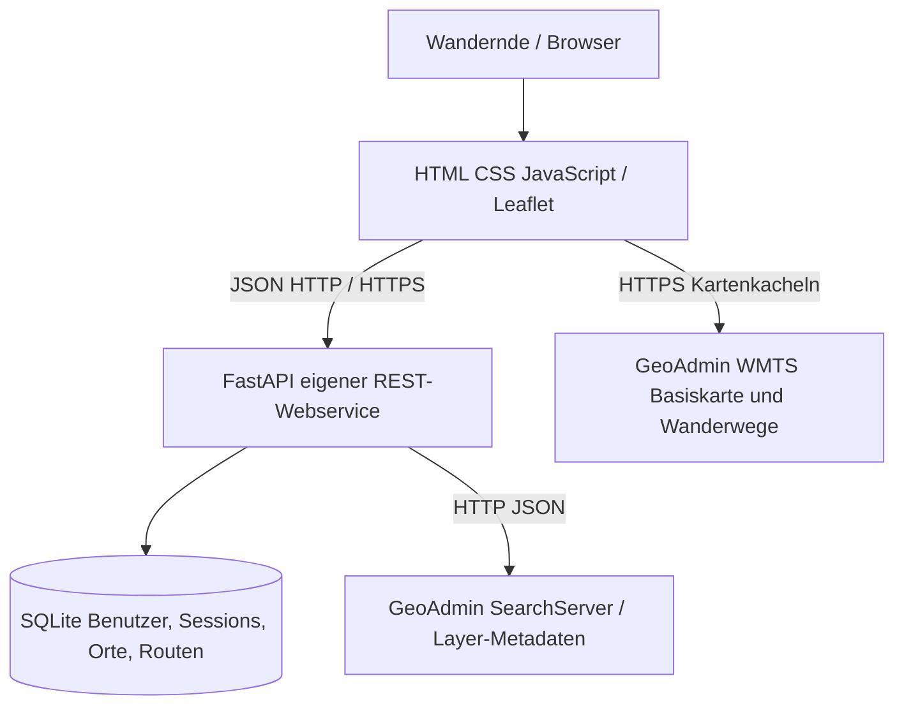

# SwissTrail – Software-Spezifikation (HSLU ANG_INF)

## 1. Kundenprofil und Problem
**Smart Travel / Tourismusbüro.** Besucher möchten Schweizer Wanderwege auf einer Karte sehen, Orte finden und eigene geplante Strecken mit Distanz und Schwierigkeitsgrad organisieren. SwissTrail ist ein **Lernprototyp**, kein sicherheitskritisches Navigationsgerät.

## 2. Funktionale Anforderungen
| ID | Funktion | Abnahmekriterium | Status |
|---|---|---|---|
| F01 | Schweizer Basiskarte laden | Basiskarte im Browser sichtbar bei Internetzugang | implementiert, Live-Test nötig |
| F02 | Wanderwege sichtbar schalten | GeoAdmin-WMTS-Layer per Knopfdruck | implementiert, Live-Test nötig |
| F03 | Orte suchen | Suche liefert per eigenem Backend GeoAdmin-Orte | implementiert, Live-Test nötig |
| F04 | Benutzer registrieren/anmelden | Benutzer in SQLite, passwortgesicherte Anmeldung | implementiert, automatisiert getestet |
| F05 | Orte verwalten | Anlegen, Auflisten, Notiz ändern, Löschen | implementiert, automatisiert getestet |
| F06 | Route zeichnen | Min. zwei Stützpunkte auf interaktiver Karte | implementiert, Browser-Test nötig |
| F07 | Distanz berechnen | Summe geodätischer 2D-Längen der Teilstrecken, km | implementiert, getestet |
| F08 | Schwierigkeit erfassen | Nutzer wählt Wanderweg/Bergwanderweg/Alpinwanderweg/nicht bewertet | implementiert, Browser-Test nötig |
| F09 | Route speichern und anklicken | Benutzerbezogen in SQLite; Klick auf Linienzug zeigt Länge und Schwierigkeit | implementiert, API getestet; Browser-Test nötig |
| F10 | Routen löschen | Nur Eigentümer darf löschen | implementiert, getestet |
| F11 | Gesundheitsschnittstelle | GET /api/health | implementiert, getestet |

**Wichtig:** Die WMTS-Wanderwege bestehen aus Rasterkacheln. GeoAdmin stellt für diesen Layer keine direkte Abfrage eines einzelnen Weges bereit. Die Routen werden durch Nutzer **manuell** digitalisiert, nicht automatisiert ans offizielle Wanderwegnetz angepasst. Berechnete Streckenlänge ist **nicht** die Länge einer automatisch erkannten Route. Schwierigkeit ist eine **Selbsteinschätzung** des Benutzers, keine aus dem GeoAdmin-Layer abgeleitete Klassifizierung. Keine Wanderzeit, Höhenmeter, SAC-T-Skala oder begehbaren Gehweganweisungen.

## 3. Nichtfunktionale Anforderungen
- Browserbasiert, responsiv, HTML/CSS/JavaScript; Karte mittels Leaflet.
- Externer API-Zugriff via FastAPI-Backend (GeoAdmin SearchServer), WMTS-Kartenkacheln direkt im Browser.
- SQLite-Datenbank-Datei über Neustarts hinweg erhalten; unter Docker als Volume.
- Cookies mit HttpOnly, SameSite=Lax, bei HTTPS Secure=1; Hashing mittels scrypt, individuelle Salts.
- Benutzertrennung serverseitig geprüft; Passwort/API-Keys nie im Repository.
- In Entwicklung schnell lokal startbar; VM über Docker Compose / Caddy / TLS konfigurierbar.
- Netzabhängigkeit: Karte, Leaflet-Bibliothek, Webfonts und API benötigen Internet.

## 4. Architektur (C4-nahe Darstellung)

## 5. Datenmodell
- `users`: id, username (unique), password_salt, password_hash, created_at.
- `sessions`: token_hash, user_id, expires_at.
- `places`: id, user_id, name, lat, lon, notes, created_at.
- `routes`: id, user_id, name, difficulty, notes, points_json, length_km, created_at.
- Relationen: jeder Ort und jede Route gehört genau einem Nutzer. SQLite-Foreign-Keys eingeschaltet.

## 6. Technische Entscheidungen und Trade-offs
1. **SQLite:** Keine externen Datenbankdienste, Datei im Docker-Volume; bei vielen gleichzeitigen Schreibenden begrenzt.
2. **FastAPI:** Eigene JSON-REST-API, Validierung mit Pydantic, Swagger `/docs`.
3. **WMTS + Nutzer-Polylinien:** Offizielle Karte direkt nutzbar; kein Graph-basiertes Routing oder automatische Zuordnung einer angeklickten WMTS-Linie möglich.

## 7. Bekannte Einschränkungen
- Distanz ist die kürzeste Verbindung zwischen den gesetzten Punkten (sum of segments); Kurven zwischen Punkten, 3D-Gelände und Höhenmeter fehlen. Für bessere Genauigkeit viele Punkte entlang des Wegs setzen.
- Schwierigkeit ist nicht automatisch validiert. Wanderweg-Kategorien sind keine zugesicherten aktuellen Bedingungen. Vor Tour die offiziellen Warnungen, Beschilderung, Wetter- und Wegsperrungen prüfen.
- Kein Offline-Modus. Keine produktionsreife Authentifizierungsplattform oder Rate-Limiting für öffentlichen Hochlastbetrieb.
- Der Server ist auf einer VM erst tatsächlich verfügbar, **wenn** die VM bereitgestellt und der Dienst dort gestartet wurde.
