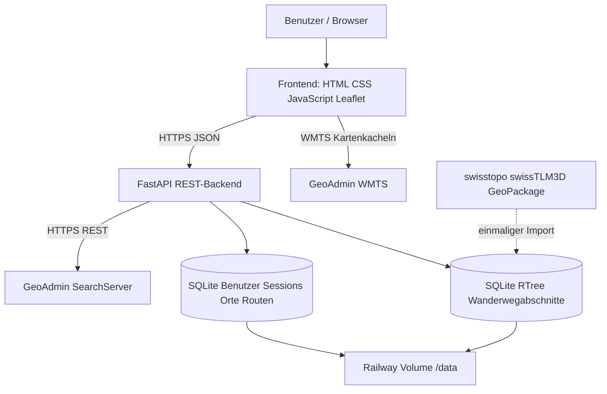

# SwissTrail – Software-Spezifikation (aktuelle Version)
## Projektidee und Kundenprofil
Smart Travel / Tourismusbüro: Schweizer Wanderwege und Orte suchen und eigene Tourideen verwalten. Schulprototyp, keine sicherheitskritische Navigation.

## Funktionale Anforderungen (mit Abnahmekriterium)
| ID | Funktion | Akzeptanzkriterium |
|---|---|---|
| F01 | Basiskarte / Wanderwege | GeoAdmin-WMTS-Kacheln laden; Wanderlayer schaltbar |
| F02 | Ortssuche | FastAPI-GET `/api/geoadmin/search` liefert Treffer als JSON |
| F03 | Wegabschnitt anklicken | GET `/api/trails/nearby` findet nächstes Segment innerhalb 65 m, Popup mit Länge und amtlicher Kategorie |
| F04 | Benutzerkonto | Registrieren, anmelden, abmelden; Konto in SQLite |
| F05 | Persönliche Merkliste | Orte speichern, Notizen ändern, Orte löschen; Benutzertrennung |
| F06 | Eigene Routen | 2–120 Punkte zeichnen; 2D-Kilometer, gewählte Schwierigkeit, speichern, aufrufen, löschen |
| F07 | Regionen entdecken | Regionskarten öffnen und zentrieren die Karte |
| F08 | Gesundheitsstatus | GET `/api/health` zeigt Backendstatus |

Die geforderten zwei wesentlichen Operationen sind die GeoAdmin-Ortssuche und die Wegsegment-Abfrage; CRUD-Funktionen gehen darüber hinaus.

## Nichtfunktionale Anforderungen
Browserbasiert, responsive HTML/CSS/JavaScript/Leaflet. REST-API mit HTTP/JSON, Pydantic-Validierung, verständliche Statuscodes. SQLite lokal und auf persistentem Volume. HTTPS und sichere Cookie-Sessions. Automatisierte Tests und dokumentierte manuelle Systemtests. Abhängigkeit von GeoAdmin für Live-Kartendarstellung und Suchergebnisse.

## Architektur (C4-nahe Komponenten)

## Datenmodell
`users(id,username,password_salt,password_hash,created_at)`; `sessions(token_hash,user_id,expires_at)`; `places(id,user_id,name,lat,lon,notes,created_at)`; `routes(id,user_id,name,difficulty,notes,points_json,length_km,created_at)`. Nutzerbezogene Datensätze referenzieren `user_id`.

Separate amtliche Datenbank `trails.db`: `trail_segments(id,category,length_km,coords_json)` und `trail_index(id,min_lon,max_lon,min_lat,max_lat)` als RTree. Beim Klick: räumliche Vorauswahl, Abstand zur Linie prüfen, nächsten passenden Abschnitt ausliefern.

## Technische Entscheidungen und Einschränkungen
1. SQLite statt Fremd-DB-Service: einfach, Datei auf Volume, begrenzte Schreibparallelität.
2. FastAPI/Pydantic: selbst entwickelte REST-Schnittstelle, automatische Validierung.
3. WMTS plus GeoPackage: anschaulicher Kartenlayer und getrennte Vektorsuche.

Die amtliche Kategorie ist nicht SAC T1–T6. Segmentlänge ist nicht Gesamtroutenlänge. Eigene Route ist Haversine-2D-Verbindung der Klickpunkte, keine automatische Wegführung, keine Höhenmeter und keine aktuelle Sperr-/Wetterlage.
## Ergänzung SwissTrail 6
| ID | Funktion | Akzeptanzkriterium |
|---|---|---|
| F09 | Routen-GPX-Export | Angemeldete Person kann eigene gezeichnete Tour als valide GPX-1.1-Trackpunkte herunterladen; HTML/XML-Sonderzeichen im Namen werden maskiert |
| F10 | Routen suchen und sortieren | Filter nach Name, Notiz oder Kategorie; Sortierung nach Name, Länge und Neueste; ohne Veränderung der gespeicherten Daten |
| F11 | Wanderwegkategorien verstehen | Übersicht über die drei offiziellen Wegkategorien inklusive begrenzter Aussagekraft und Sicherheitshinweis |

Die GPX-Datei stellt eine selbst gezeichnete Linie dar und darf nicht als routenoptimierte Navigationsanweisung interpretiert werden.
